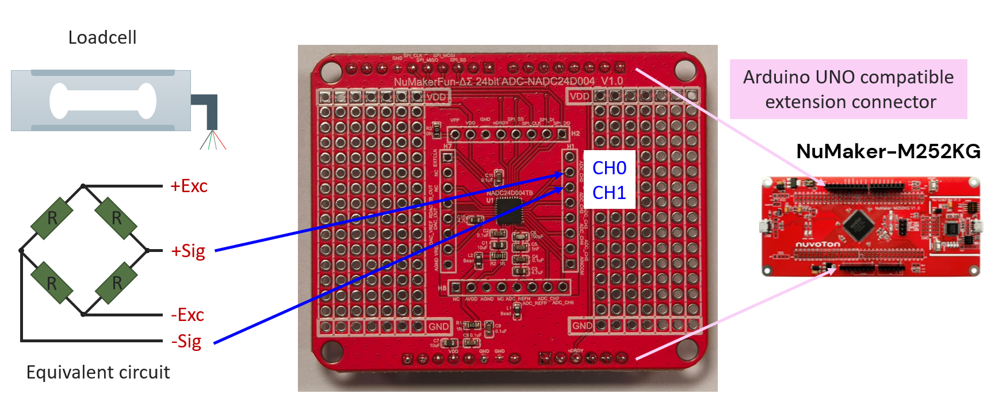

# Nuvoton NuMaker-M252KG with NuMakerFun-NADC24D004 Weighing Sensor Application

This project demonstrates how to interface the **NuMaker-M252KG development board** with the **NuMakerFun-NADC24D004 expansion board**, featuring the **NADC24D004TB (24-bit Delta-Sigma ADC)**, via SPI. It provides differential analog data acquisition for electronic scale applications, such as weighing scales, counting scales, and refrigerant scales.

## 🚀 Key Features

* **High-Precision 24-bit Conversion:** Processes 24-bit signed ADC data and calculates the input voltage using a **2.4 V reference** and **1x PGA gain**.
* **NuMaker Expansion Interface:** Connects to the NuMaker-M252KG through **Arduino UNO-compatible extension connectors**.
* **Interrupt-Driven Ready Detection:** Uses a GPIO falling-edge interrupt on `PB.5` to detect the NADC24D004TB data-ready signal.
* **Efficient SPI Link:** Configured in **SPI Master Mode 0**, with a requested clock of **10 MHz** (nominal **9.6 MHz** with the current clock divider).
* **Startup Offset Calibration:** Measures and compensates for the ADC offset before normal acquisition.

---

## 📊 Hardware & Interface Architecture

The following illustration shows the differential sensor connection and the NuMaker expansion interface:

### Pin Mapping

| MCU Pin | Peripheral | Connected To (NADC24D004TB) | Signal Description |
| :--- | :--- | :--- | :--- |
| **PA.0** | SPI0_MOSI | SPIDI / MOSI | Serial Data Input |
| **PA.1** | SPI0_MISO | SPIDO / MISO | Serial Data Output |
| **PA.2** | SPI0_CLK | SPI_CLK | Serial Clock (Schmitt Trigger enabled) |
| **PA.3** | SPI0_SS | SPI_SS | Active-Low Chip Select |
| **PB.5** | GPIO Input | nDRDY | **Data Ready Pin** (Falling-edge triggers `GPB_IRQHandler`) |
| **PB.12/13** | UART0 | Debug Console | Serial Log Output (`115200, 8-N-1`) |

**Input Polarity:** The firmware selects **CH1 as the positive input** and **CH0 as the negative input**, measuring `V(CH1) - V(CH0)`. For a positive sensor reading, connect `+Sig` to CH1 and `-Sig` to CH0; these are opposite to the signal connections shown in the illustration.

---

## 🛠️ Data Processing Logic

The acquisition flow uses a GPIO interrupt to read and process ADC samples:

1. **Hardware Signaling:** The NADC24D004TB completes a conversion and pulls the `nDRDY` line (`PB.5`) **LOW**.
2. **Interrupt Handling (`GPB_IRQHandler`):** The MCU detects the falling edge, clears the interrupt flag, and calls `SPI_SetChannel_and_ReadADCData()` to retrieve the raw 24-bit sample.
3. **Sign Extension:** Converts the raw 24-bit result into a signed 32-bit integer (`int32_t`).
4. **Voltage Conversion:** Calculates the differential input voltage using the current 2.4 V reference and 1x gain settings:

   `Volt = (s32AdcData / 8388608.0) * 2.4`

5. **UART Reporting:** Prints the signed ADC count and calculated voltage through UART0.

---

## 💻 Environment

* **Host Board:** NuMaker-M252KG
* **MCU:** Nuvoton NuMicro M252KG6AE (Cortex-M23 core)
* **External ADC:** NuMakerFun-NADC24D004 expansion board with NADC24D004TB
* **IDE:** Keil MDK uVision
* **Clock:** 48 MHz Internal High-Speed RC Oscillator (HIRC) as HCLK
* **Project:** `SampleCode/ExampleCode/KEIL/NuMakerFun_NADC24D004_Example.uvprojx`
* **Schematic:** [NuMakerFun-NADC24D004 V1.0](Schematic/SCH_NuMakerFun-NADC24D004_V1.0_2026-11-19.pdf)
